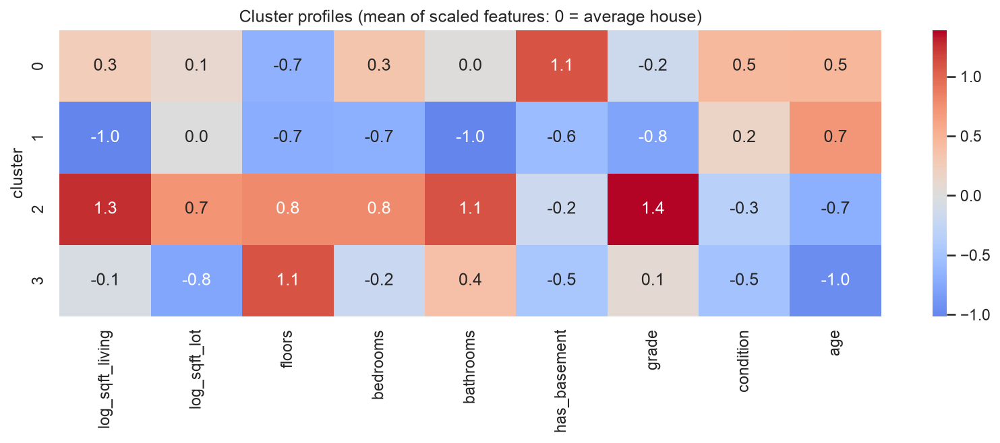
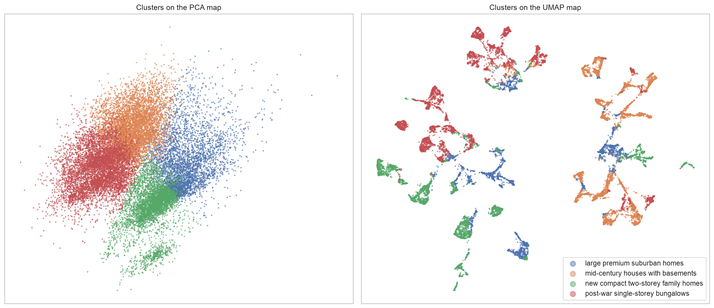
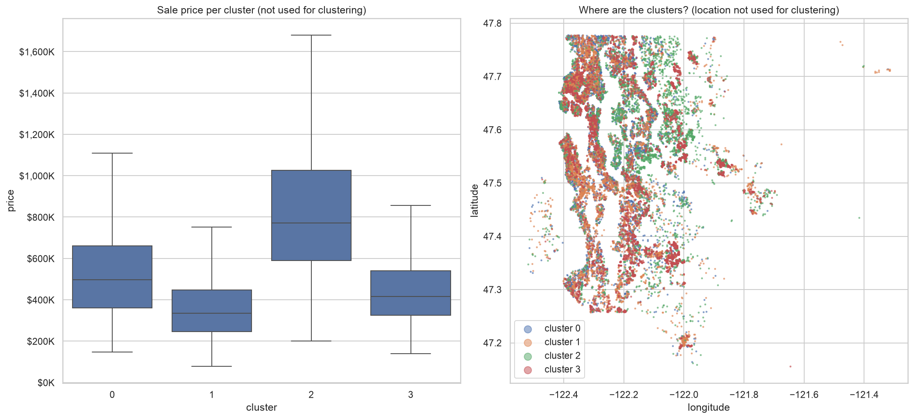

# House typologies in King County (Seattle area)

**Team:** Ugo, Alvaro, Sneha (Team 7)
**Course:** AI Methods I – Day 3: Unsupervised learning (IAAC MaAI 2026/27)
**Dataset on Hugging Face:** https://huggingface.co/datasets/iaac-maai/day3-group7-king-county-house-typologies
**Model on Hugging Face:** https://huggingface.co/iaac-maai/day3-group7-house-typologies

## Use case

An architect, developer or municipality wants to know which **types of houses** make up the housing stock of King County, for example to choose which type to target first in a retrofit programme, or to design a new housing product for the most common type. We group houses that are similar **as buildings** (size, plot, floors, rooms, basement, quality, condition, age) and leave price and location out, so we can use them afterwards to check what the types mean. A group is useful if an architect would recognise it as a house type and someone could act on it.

## Dataset

| | |
|---|---|
| **Name** | House Sales in King County, USA |
| **Source** | [Kaggle: harlfoxem/housesalesprediction](https://www.kaggle.com/datasets/harlfoxem/housesalesprediction) · [our clustered version on Hugging Face](https://huggingface.co/datasets/iaac-maai/day3-group7-king-county-house-typologies) |
| **Rows used** | 21,418 (one row = one house, its most recent sale between May 2014 and May 2015) |
| **Licence** | CC0 1.0 (Public Domain) |

We start from the cleaned dataset of our Day 1/2 work (`data/housing_clean.csv`: 18 impossible rows removed from 21,613 sales) and keep only the latest sale of the 177 houses sold twice.

## Repository structure

```
├── data/
│   ├── .gitkeep
│   └── housing_clean.csv           # cleaned Day 1/2 dataset (2.4 MB), loaded by the notebook
├── dataset/
│   ├── README.md                   # Hugging Face dataset card
│   ├── clusters_map.png            # figure shown in the dataset card
│   └── king_county_house_typologies.csv   # the clustered data (NOT committed: on Hugging Face)
├── figures/                        # 8 plots exported by the notebook
├── models/
│   ├── README.md                   # Hugging Face model card
│   └── model.joblib                # fitted pipeline (NOT committed: on Hugging Face)
├── notebook/
│   └── unsupervised_learning.ipynb # data → features → PCA/UMAP → clustering → named clusters → exports
├── .gitignore
├── LICENSE
├── README.md
└── requirements.txt
```

## How to run

```bash
python3.11 -m venv .venv
source .venv/bin/activate        # Windows: .venv\Scripts\activate
pip install -r requirements.txt
```

Open `notebook/unsupervised_learning.ipynb`, select the `.venv` kernel and run all cells. It reads `data/housing_clean.csv`, writes the figures to `figures/`, the model to `models/model.joblib` and the clustered dataset to `dataset/`. UMAP takes about a minute.

To publish (needs `pip install huggingface_hub` and `hf auth login` with your own token):

```bash
hf upload iaac-maai/day3-group7-king-county-house-typologies dataset . --type dataset
hf upload iaac-maai/day3-group7-house-typologies models .
```

## Approach

- **Unit of analysis:** one row = one house. No aggregation needed.
- **Features clustered on (9):** `log_sqft_living`, `log_sqft_lot`, `floors`, `bedrooms`, `bathrooms`, `has_basement`, `grade`, `condition`, `age`. **Kept aside for interpretation:** price, latitude/longitude, zipcode, waterfront, view, renovation, neighbours' living area.
- **Preprocessing:** log10 of living and lot area (strongly right-skewed); `StandardScaler` inside a `Pipeline`. Floor area ratio, `sqft_above` and `renovated` left out (redundant, or a rare flag that would form its own cluster).
- **Dimensionality reduction:** PCA (PC1 = size/quality/newness 39 %, PC2 = older one-storey house with basement in good condition 19 %, PC3 = large plot without basement 12 %; 4 components for 80 %) and UMAP (`n_neighbors=30`, `min_dist=0.1`).
- **Methods:** K-Means (k = 2–10, elbow and silhouette) and hierarchical clustering (Ward, dendrogram). **Final choice: K-Means with k = 4**, because no k stands out on the silhouette (flat, 0.21–0.26), and k = 4 is the most stable and interpretable solution (k = 5 was unstable across seeds).
- **Agreement and stability:** K-Means vs Ward ARI = 0.63; K-Means across 5 seeds mean ARI = 0.997; across 5 random 80 % subsamples mean ARI = 0.993.

## Results

| Cluster | Name | Size | Defining features (medians) |
|---|---|---|---|
| 0 | mid-century houses with basements | 6,095 (28.5 %) | 93 % with basement, 1 floor, 2,100 sqft, 53 years, best condition; inner Seattle; $497K |
| 1 | post-war single-storey bungalows | 6,388 (29.8 %) | 1,260 sqft, 1 floor, 1 bathroom, 62 years; central Seattle; $334K but highest $/sqft |
| 2 | large premium suburban homes | 4,080 (19.0 %) | 3,190 sqft on 11,445 sqft plots, grade 9, 19 years; Eastside; $771K |
| 3 | new compact two-storey family homes | 4,855 (22.7 %) | 11 years, 2 floors, 2.5 bathrooms, smallest plots (4,725 sqft); southern/eastern suburbs; $415K |

Without using location, the types separate by place: the two older types are in Seattle itself, the two newer ones in the suburbs. The clusters are very stable but not sharply separated (silhouette 0.23): house types form a continuum.







## Limitations

- Only houses **sold** in 2014–15 in one US county: no unsold houses, apartments or other building types. The types describe that market, not the whole building stock.
- The groups depend on our features and on k; they are one reasonable reading, not the truth. At k = 6 a small "urban townhouse" group appears.
- Low silhouette (0.23): many houses sit between two types, and their label means less than that of a typical house.
- The clusters must not be used for other regions, to value a house, or to judge an individual property.
- The published data keeps the exact coordinates, sale date and price of each house (as in the public original); use it for aggregate analysis only.

## AI usage disclosure

| | |
|---|---|
| **Tools** | Claude (Anthropic) only, including Claude Code as an agent that read and edited files in our repository and ran Python to check results. No other AI tools. |
| **Why** | To help us analyse the data and write the code faster: reading PCA loadings and cluster profiles, and writing the clustering, plotting and export code. Later, to check our submission against the brief and draft the documentation. |
| **Where** | Notebook: help with the analysis (feature choice, PCA/UMAP, choice of k, stability check, interpretation of the profiles, first cluster-name suggestions) and with the code. Documentation: the model card, dataset card, this README, `requirements.txt` and `.gitignore`. |
| **How** | We asked Claude to apply the class notebook's method to our cleaned Day 1/2 data, ran the code ourselves and checked the outputs. For the documentation we asked Claude Code to check our repository against the assignment brief and write the missing files; it took every number from the executed notebook's outputs and checked that the saved model reproduces the published `cluster` column. We reviewed the numbers and names against the notebook. |

**Lessons learned:** Claude was fast at writing the clustering and plotting code, but its readings of the results need checking against the actual outputs. Our first text for the PCA loadings had PC2 and PC3 the wrong way round; we only caught it when the loadings were recomputed and compared to the heatmap. Asking the agent to check the repository against the brief's checklist was useful: it found missing files (cards, `requirements.txt`) and data and model files that should not have been committed to GitHub.

The cluster names started as suggestions from Claude. We kept them only after checking each against the profile table (size, floors, basement, age, grade) and the cross-tabs with price, zipcode and location in section 5 of the notebook, and we can defend each name from those tables.

## License

Code and model released under the [MIT License](LICENSE). The data is [House Sales in King County, USA](https://www.kaggle.com/datasets/harlfoxem/housesalesprediction), released under CC0 1.0.
